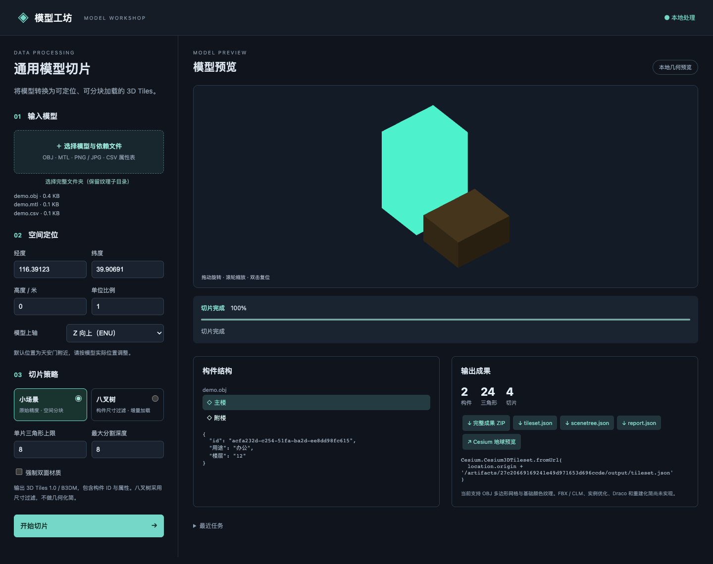

# 通用模型切片

将 OBJ 模型转换为带地理定位和构件属性的 3D Tiles。处理流程是 **导入 → 归一化资源库 → 空间分块 / 构件尺寸过滤 → 地理定位 → 3D Tiles + 构件结构树**。

## 启动

Python 3.10+，转换器和本地页面均无第三方 Python 依赖。

```sh
PYTHONPATH=src python3 -m model_tiler.cli serve --port 8080
```

打开 <http://127.0.0.1:8080>，点击“加载演示模型”，或选择自己的 OBJ、MTL、纹理与 CSV。有纹理子目录时使用“选择完整文件夹”。页面提供进度、取消、历史任务、几何旋转、构件选中、属性与结果链接。

本地几何预览离线可用；“Cesium 地球预览”使用固定版本 Cesium 1.123.1 的公共 CDN，需要联网，无需 ion token。地球预览实际读取输出 B3DM，并可点击构件查看属性。

## 命令行转换

```sh
PYTHONPATH=src python3 -m model_tiler.cli convert \
  src/model_tiler/web/demo.obj \
  --properties src/model_tiler/web/demo.csv \
  --longitude 116.39123 --latitude 39.90691 --height 0 \
  --up-axis Z --scale 1 \
  --mode small --max-triangles 50000 \
  --resource workspace/model-resource.json \
  --output workspace/my-tiles
```

多个 OBJ 可以写在 `convert` 后。默认 OBJ 坐标单位为米，Z 向上；Y 向上模型使用 `--up-axis Y`。输入原点放到指定经纬度/椭球高度。当前仅支持本地 ENU 空间参考，不转换 EPSG 投影坐标。

已有资源库可以跳过导入，改用八叉树尺寸过滤：

```sh
PYTHONPATH=src python3 -m model_tiler.cli convert \
  --skip-import --resource workspace/model-resource.json \
  --mode octree --visible-pixels 25 --max-depth 8 \
  --output workspace/my-octree-tiles
```

输出目录和资源缓存不会覆盖已有文件。页面任务存储在 `workspace/<任务ID>/`；服务重启将未完成任务标记为 `interrupted`。可用该任务的 `resource.json` 从 CLI 重新切片。

## 输入与输出

- OBJ：UTF-8，支持正/负索引、对象/组、法线、UV、凸/凹多边形耳切三角化。
- MTL：`Kd`、`d` / `Tr`、`map_Kd` PNG/JPEG，材质与纹理嵌入 GLB。暂不支持法线贴图、贴图变换选项、动画；遇到这些贴图指令会明确报错。纹理透明通道不会自动推断 MASK/BLEND。
- CSV：UTF-8，第一列按构件名称关联，其余列作为 Batch Table 属性。每个构件带独立 `id`、`name`。
- 输出：`tileset.json`、`tiles/*.b3dm`、`scenetree.json`、`report.json`、本地预览用 `preview.json`。结构树的 `sphere` 是 ECEF 世界坐标；`boundingVolume.box` 是根 transform 下的 ENU 坐标。

小场景按三角形重心排序递归分块，保留全部几何；跨分块的三角形完整保留且各块包围体覆盖实际几何。八叉树按构件 AABB 尺寸 / 当前块尺寸 × 512 与像素阈值比较，较小构件下移到子层，使用 `refine: ADD`，每个构件只分配一次。到深度上限后保留全部数据；超限切片记录在报告中。

本版本输出 **3D Tiles 1.0/B3DM**。当前尚未实现 FBX/CLM/UDS/SHP 导入、几何重建化简、I3DM/CMPT 实例优化、Draco、纹理图集、数据库输出。小场景的阈值采用三角形数。模型在内存中归一化，大型 BIM 应扩展为磁盘资源库后处理。页面原始文件上传约 47 MB 上限；更大输入使用 CLI。

## 接入 Cesium 项目

将输出目录通过 HTTP 提供，再加载：

```js
const tileset = await Cesium.Cesium3DTileset.fromUrl('/models/tileset.json');
viewer.scene.primitives.add(tileset);
await viewer.zoomTo(tileset);
// 点击拾取到 Cesium3DTileFeature 后：
// feature.getProperty('id'); feature.getProperty('name');
```

B3DM 的布局与 Batch Table 遵循 [CesiumGS 的格式规范](https://github.com/CesiumGS/3d-tiles/tree/main/specification/TileFormats/Batched3DModel)。

## 测试与验证

```sh
PYTHONPATH=src python3 -m unittest discover -s test -v
# 服务运行时，使用已安装的 Playwright 和 Chrome：
node scripts/verify_browser.cjs
```

验证结果在 `verification/`。`examples/demo-tiles/` 和 `examples/demo-octree/` 是实际转换成果，`examples/demo-resource.json` 是可重复使用的资源库。


